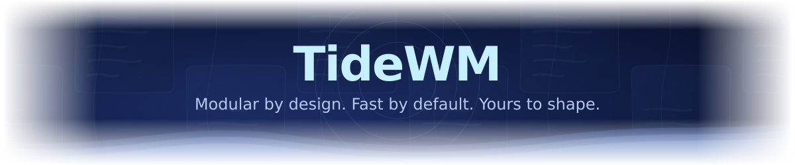
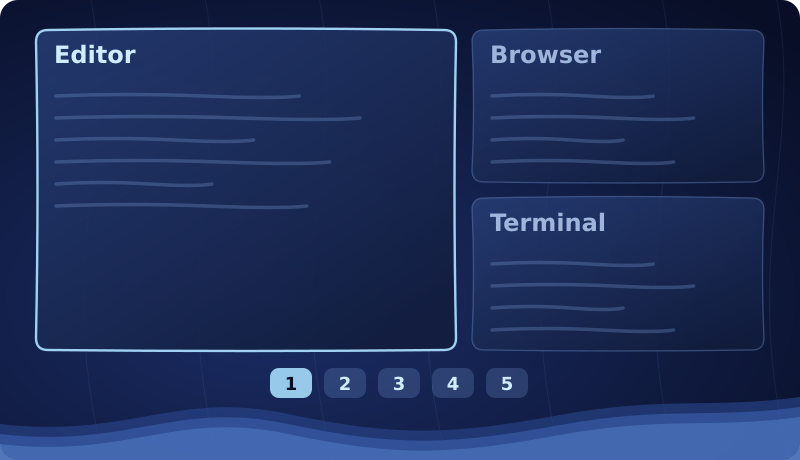
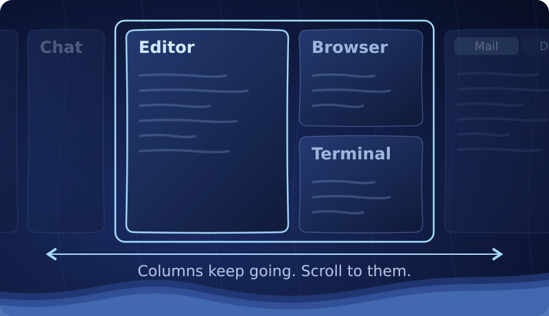
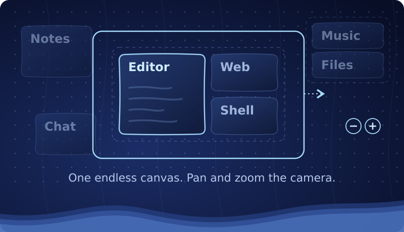
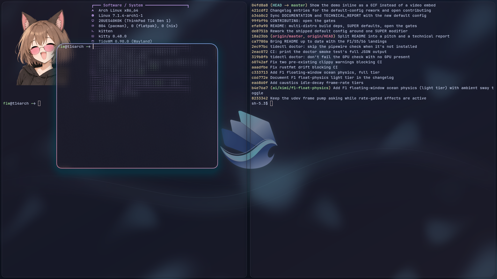
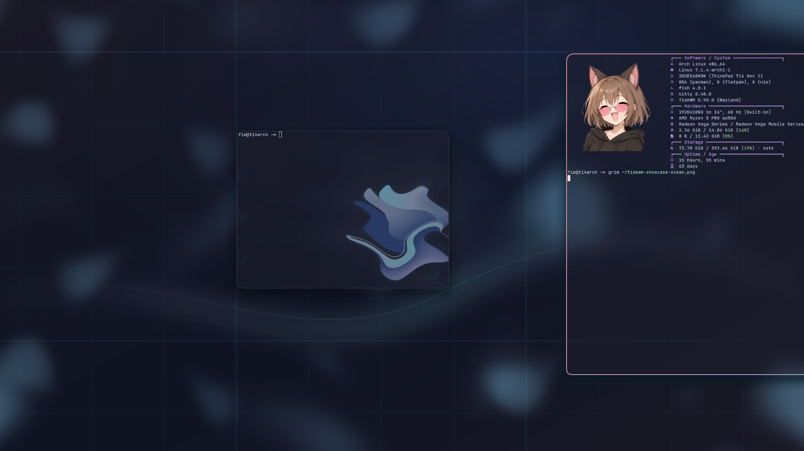

<div align="center">



### A modular Wayland window manager that stays out of your way.

[](LICENSE)


[](https://github.com/Fi3w0/TideWM/stargazers)
[](https://discord.gg/ZhkxA83cKk)

[**Install**](#install) · [**Three ways to work**](#three-ways-to-work) · [**Wave config**](#wave-your-best-config) · [**Docs**](DOCUMENTATION.md) · [**Changelog**](CHANGELOG.md)

</div>

Pick how your windows behave: tiled workspaces, scrolling columns or an endless canvas. Switch between them live without closing a single app. Everything else is yours too: your bar, your launcher, your look, one readable config file that reloads on save.


<p align="center"><sub><a href="share/media/demo-clasic.mp4">Watch in full quality (mp4)</a></sub></p>

## Three ways to work

<table>
<tr>
<th width="33%">Classic</th>
<th width="33%">Scroll</th>
<th width="33%">Ocean</th>
</tr>
<tr>
<td></td>
<td></td>
<td></td>
</tr>
<tr>
<td valign="top"><b>Tiles and workspaces.</b> BSP, master/stack or cascade, numbered workspaces per monitor, floating when you want it.</td>
<td valign="top"><b>An endless strip of columns.</b> New windows open beside you instead of squeezing the rest. Stack or tab a column, cycle preset widths.</td>
<td valign="top"><b>An infinite canvas.</b> Group windows into reefs or drop them anywhere, then pan and zoom. One camera per monitor, or one shared view.</td>
</tr>
</table>

```sh
tidectl engine scroll   # every open window comes along
```

<details>
<summary><b>Coming from another window manager?</b></summary>

<br>

| You use… | Start with | What carries over |
| --- | --- | --- |
| Hyprland, Sway, i3 | **Classic** | Dwindle-style tiling, per-monitor workspaces, scratchpads, submaps (`mode`), window rules, gaps, a JSON IPC socket |
| niri, PaperWM | **Scroll** | Scrolling columns, consume/expel, stacked and tabbed columns, preset widths, center-focused column |
| driftwm, a canvas desktop | **Ocean** | Pan/zoom camera, bookmarks, free placement, a whole-world minimap |

These describe the workflow, not drop-in config compatibility. TideWM's own guide: [Spatial model](SPATIAL_MODEL.md).

</details>

## What you get

<table>
<tr>
<td width="50%" valign="top">

**🧩 Built from parts you choose**<br>
Waybar, Quickshell, eww, rofi, hyprlock, swww: standard Wayland protocols mean your tools just work. TideWM manages windows and leaves the desktop to you.

</td>
<td width="50%" valign="top">

**⚡ Light, and measured**<br>
About 50 MB for plain tiling and 60–70 MB with every effect on (AMD, PSS). With the defaults, an idle desktop renders nothing. `tidectl perf` and `tidectl doctor` show what your setup costs.

</td>
</tr>
<tr>
<td valign="top">

**🎨 Your look, down to the shader**<br>
Rounding, gradient borders, shadows, frost and water glass, open/close/move animations, custom GLSL. The water effects are a toggle each, or all off.

</td>
<td valign="top">

**🖥️ Real-desktop ready**<br>
Mixed-scale monitors, hotplug, X11 apps via xwayland-satellite, screenshots, OBS and Discord screen sharing, session lock, tablets and touch.

</td>
</tr>
<tr>
<td valign="top">

**🔌 Scriptable to the core**<br>
`tidectl` drives every action. `tidectl subscribe` streams window, workspace and focus events, so your bar never polls.

</td>
<td valign="top">

**🌊 A little water, if you want it**<br>
Ripples on open, wave workspace transitions, windows that sway when dragged. Personality, not a requirement.

</td>
</tr>
</table>

<details>
<summary><b>Real screenshots</b></summary>

<br>

| Classic | Ocean |
| --- | --- |
|  |  |

</details>

## Wave your best config!

**Wave reads like a settings file and grows into a programming language only if you ask it to.** Start with `key = value` and a few braces. It's as friendly as YAML, with no indentation traps and no quoting rules to memorize.

```text
# ~/.config/tidewm/config.wave (created with working defaults on first launch)
engine = scroll
gaps   = 10

border {
    width = 2
}

@mod = SUPER
bind $mod+Return { spawn:kitty }
bind $mod+Q      { close-window }
```

Save, and it's live. A typo shows you the file and line on screen while your last good config keeps running.

**Underneath, it is Lua.** The same file takes loops, functions, typed colors and durations, hardware checks and event handlers, so one config can follow you across every machine:

```text
for i = 1, 9 do                         # nine workspace binds, one loop
    bind $mod+Num$i { workspace:$i }
end

theme {
    primary = #8EDDFF
    deep    = primary.darken(0.35)      # colors are real values
}

if tide.gpu.vendor == "nvidia" then     # per-machine settings, same file
    gaps = 6
end

on "workspace-changed" {                # react to your session
    if tide.workspace == 3 then spawn("kitty --class notes") end
}
```

Split it with `include`, format it with `wavefmt`, ask the running session anything with `tidectl eval`. → [The Wave guide](WAVE.md) · [Every key and action](DOCUMENTATION.md)

## Install

> [!NOTE]
> TideWM is in **beta** and built by one person. It is a daily driver on Arch and Gentoo (AMD and NVIDIA); other distros should work, and reports are very welcome.

| Distro | Command |
| --- | --- |
| Arch and derivatives | `packaging/arch/install.sh` |
| Gentoo | `packaging/gentoo/install.sh` |
| NixOS / Nix | `NIXPKGS_ALLOW_UNFREE=1 nix run --impure github:Fi3w0/TideWM` <sub>(the logo is non-commercial)</sub> |
| Anything else | `./install.sh` after the [build dependencies](TECHNICAL_REPORT.md#building) |

Then pick **TideWM** in your display manager. Details: [packaging guide](packaging/README.md).

> [!TIP]
> **Just looking?** Run it in a window inside your current desktop. Nothing on your system changes:
> ```sh
> git clone https://github.com/Fi3w0/TideWM && cd TideWM
> cargo run --locked --release
> ```

<details>
<summary><b>Build dependencies per distro</b></summary>

```sh
# Arch
sudo pacman -S pkg-config wayland systemd-libs libinput libxkbcommon mesa libdrm seatd
# Fedora
sudo dnf install pkgconf-pkg-config wayland-devel systemd-devel libinput-devel libxkbcommon-devel mesa-libEGL-devel mesa-libgbm-devel libdrm-devel libseat-devel
# Debian / Ubuntu
sudo apt install pkg-config libwayland-dev libudev-dev libinput-dev libxkbcommon-dev libegl1-mesa-dev libgbm-dev libdrm-dev libseat-dev
# Gentoo (systemd or OpenRC)
sudo emerge --ask dev-util/pkgconf dev-libs/wayland dev-libs/libinput x11-libs/libxkbcommon media-libs/mesa x11-libs/libdrm sys-auth/seatd sys-fs/eudev
```

Screen sharing (OBS, Discord, browsers) needs `--features screencast` and clang/libclang at build time.

**GL apps slow but TideWM smooth?** Your user can't reach `/dev/dri/renderD*`; add the `video` group or a `uaccess` rule.

</details>

<details>
<summary><b>Default shortcuts</b></summary>

<br>

| Keys | Action | Keys | Action |
| --- | --- | --- | --- |
| <kbd>Super</kbd> <kbd>Enter</kbd> | Terminal | <kbd>Super</kbd> <kbd>1</kbd>…<kbd>0</kbd> | Workspace |
| <kbd>Super</kbd> <kbd>Q</kbd> | Close window | <kbd>Super</kbd> <kbd>Shift</kbd> <kbd>1</kbd>…<kbd>0</kbd> | Move to workspace |
| <kbd>Super</kbd> <kbd>H</kbd><kbd>J</kbd><kbd>K</kbd><kbd>L</kbd> | Focus | <kbd>Super</kbd> <kbd>O</kbd> | Overview |
| <kbd>Super</kbd> <kbd>Shift</kbd> <kbd>H</kbd><kbd>J</kbd><kbd>K</kbd><kbd>L</kbd> | Swap window | <kbd>Super</kbd> <kbd>Tab</kbd> | Cycle focus |
| <kbd>Super</kbd> <kbd>V</kbd> | Float | <kbd>Super</kbd> <kbd>-</kbd> | Scratchpad |
| <kbd>Super</kbd> <kbd>F</kbd> | Fullscreen | <kbd>Super</kbd> <kbd>Shift</kbd> <kbd>Q</kbd> | Quit TideWM |

Every bind lives in your `keybinds.wave`; nothing is hidden or hardcoded.

</details>

## Join in

<div align="center">

**Like where TideWM is heading? [⭐ Give it a star](https://github.com/Fi3w0/TideWM)**<br>
<sub>It takes one click and helps a one-person project reach people who would enjoy it.</sub>

</div>

Bug reports from new hardware are the most useful thing you can send right now. I build TideWM with help from AI coding agents and check every change on real hardware before trusting it.

[**Discord**](https://discord.gg/ZhkxA83cKk) · [**Open an issue**](https://github.com/Fi3w0/TideWM/issues/new/choose) · [**Contribute**](CONTRIBUTING.md) · [**What's verified where**](TECHNICAL_REPORT.md)

<details>
<summary><b>License</b></summary>

- **TideWM code, including its bundled Wave configuration engine:** GPL-3.0-or-later, see [LICENSE](LICENSE).
- **TideWM logo:** [Creative Commons Attribution-NonCommercial-ShareAlike 4.0 International](LICENSES/CC-BY-NC-SA-4.0.txt), see the [logo notice](share/icons/LICENSE).
- **Standalone Scorium:** a separate project with its own [custom source-available license](https://github.com/Scorium-lang/scorium-rs/blob/main/LICENSE), labelled PolyForm Strict 1.0.0. Its restrictions apply to that project; TideWM's bundled Wave code stays GPL.
- **Bundled Adwaita Sans font:** [SIL Open Font License 1.1](assets/fonts/OFL-LICENSE.txt).

Copyright (C) 2026 Fi3w0 and contributors. See [LICENSING.md](LICENSING.md) for scope, attribution and packaging details.

</details>

<br>

<div align="center">
<sub>Built on <a href="https://github.com/Smithay/smithay">Smithay</a>. Inspired by and borrows implementation patterns from <a href="https://github.com/YaLTeR/niri">niri</a>, <a href="https://github.com/malbiruk/driftwm">driftwm</a>, <a href="https://github.com/hyprwm/Hyprland">Hyprland</a>, and <a href="https://github.com/swaywm/sway">sway</a>.</sub>
</div>
